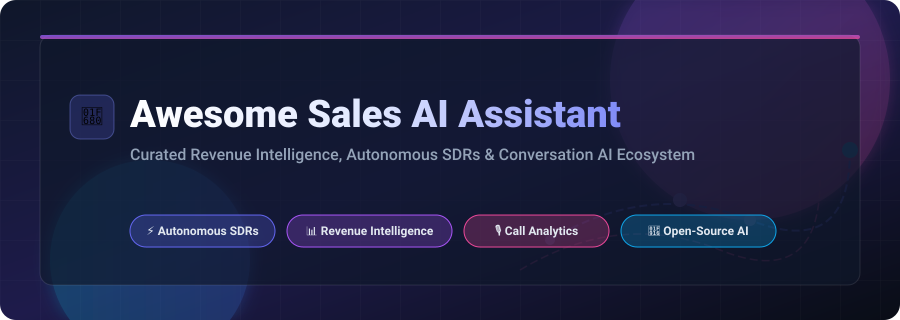

  

# 🤖 Awesome Sales AI Assistant

  
  
  
  
  

> **A curated ecosystem of SaaS platforms & Open-Source AI projects focused on Revenue Intelligence, Autonomous SDRs, Conversation Analytics, and AI-powered Sales Automation.**

---

## 📌 Table of Contents

- [📊 Market Overview & Industry Insights](#-market-overview--industry-insights)
- [🏢 SaaS & Hosted Commercial Platforms](#-saas--hosted-commercial-platforms)
- [💻 Open-Source GitHub Projects](#-open-source-github-projects)
- [🤝 How to Contribute](#-how-to-contribute)
- [⚠️ Disclaimer & Compliance](#%EF%B8%8F-disclaimer--compliance)
- [📈 Star History](#-star-history)

---

## 📊 Market Overview & Industry Insights

> 💡 **Market Size & Structure**: The Global **Sales AI & Revenue Intelligence** market size is estimated at **$5.2 Billion in 2026** and projected to reach **$18.4 Billion by 2032** growing at a CAGR of ~23.5%. The market structure is currently **moderately fragmented**: enterprise incumbents (Salesforce, Gong) lead full-suite conversation & deal intelligence, while specialized autonomous SDRs, email hyper-personalization engines, and local privacy-first frameworks create vibrant competition.

---

## 🏢 SaaS & Hosted Commercial Platforms

The table below outlines leading enterprise SaaS platforms in the Sales AI space, sorted by **Company Size & Market Valuation (descending)**.

| Product | Description & Core Capabilities | Starting Price | Free Tier / Trial Limit | Company Size / Valuation |
| :--- | :--- | :--- | :--- | :--- |
| ⚡ **[Salesforce Sales AI](https://www.salesforce.com/)** | Einstein Copilot native AI for pipeline forecasting, automated lead scoring, and meeting summaries. | **$25/user/month** (Starter Suite) | **30-day free trial** (Full feature access) | **~$250 Billion** Market Cap ($38B ARR) |
| 🎙️ **[Gong](https://www.gong.io/)** | Category leader in conversation intelligence, deal risk analytics, and automated sales coaching. | **$1,200/user/year** (+ base fee) | **14-day free trial** (Guided sandbox) | **$7.2 Billion** Valuation ($250M ARR) |
| 📧 **[Outreach](https://www.outreach.io/)** | Sales execution platform with automated multi-channel sequences, deal intelligence, and AI rep coaching. | **$100/user/month** (Annual plan) | **14-day interactive trial** (Guided tour) | **$4.4 Billion** Valuation ($200M ARR) |
| 📈 **[Salesloft](https://www.salesloft.com/)** | Revenue orchestration platform providing cadence automation, call transcription, and deal health scoring. | **$75/user/month** (Essentials) | **14-day free trial** (Upon request) | **$2.3 Billion** Valuation ($150M ARR) |
| 🤖 **[People.ai](https://people.ai/)** | Revenue intelligence engine that auto-captures sales activity, maps buying groups, and tracks deal risk. | **$50/user/month** (Enterprise tier) | **14-day free trial** (Enterprise sandbox) | **$1.1 Billion** Valuation ($100M ARR) |
| 💡 **[Clari Copilot](https://www.clari.com/)** | Real-time conversation intelligence, battle-cards during calls, and CRM activity sync. | **$60/user/month** (Growth tier) | **14-day free trial** (No credit card needed) | **$1.0 Billion** Valuation ($100M ARR) |
| ✍️ **[Regie.ai](https://www.regie.ai/)** | Generative AI platform for outbound sequence creation, personalized email writing, and AI agent execution. | **$59/user/month** (Pro plan) | **Free Forever tier** (20 emails/mo) & 14-day trial | **$120 Million** Valuation ($15M ARR) |
| 🎯 **[Attention](https://www.attention.tech/)** | AI sales assistant that record calls, updates CRM fields automatically, and deploys 30 post-call coaching agents. | **$49/user/month** (Standard) | **14-day free trial** (Full features) | **$65 Million** Valuation ($8M ARR) |
| 📩 **[Lavender](https://www.lavender.ai/)** | AI email assistant scoring cold emails, recommending real-time improvements, and boosting reply rates. | **$29/user/month** (Individual) | **Free Forever tier** (5 scores/mo) & 14-day trial | **$50 Million** Valuation ($6M ARR) |
| 📝 **[Scratchpad](https://www.scratchpad.com/)** | Sales workspace streamlining CRM data entry, pipeline updates, and deal notes sync. | **$19/user/month** (Pro plan) | **Free Forever plan** (100 syncs/mo) & 14-day Pro trial | **$40 Million** Valuation ($5M ARR) |

---

## 💻 Open-Source GitHub Projects

Below is a curated selection of open-source Sales AI projects, agent frameworks, and self-hosted tools, sorted by **GitHub Star Count (descending)**.

| Project & Repo | Description & Key Features | Stars | Tech Stack & License |
| :--- | :--- | :--- | :--- |
| 💬 **[DeskcommCRM](https://github.com/melgarafael/DeskcommCRM)** | Open-source AI sales OS & self-hosted CRM with native AI agents + WhatsApp (WAHA) integration. Open alternative to Kommo & Intercom. |  | TypeScript, Node.js • LGPD |
| 🧠 **[ai-marketing-skills](https://github.com/ericosiu/ai-marketing-skills)** | Open-source AI marketing & sales skills — growth experiments, sales pipeline automation, outbound lead generation, and content ops. |  | Python, AI Skills • MIT |
| 🤖 **[SalesGPT](https://github.com/filip-michalsky/SalesGPT)** | Context-aware AI Sales Agent designed to automate complex sales conversations, lead qualification, and cold outreach. |  | Python, LangChain • Apache 2.0 |
| 👥 **[ai-sales-team-claude](https://github.com/zubair-trabzada/ai-sales-team-claude)** | Autonomous AI sales team for Claude Code — qualifies leads (BANT + MEDDIC), researches prospects, writes proposals, and generates PDF pipeline reports. |  | Claude Code Skills • MIT |
| 🔗 **[sales-outreach-automation-langgraph](https://github.com/kaymen99/sales-outreach-automation-langgraph)** | Automates lead research, qualification, and multi-step outreach with AI agents built on LangGraph & CRM integrations (HubSpot, Airtable). |  | Python, LangGraph • MIT |
| 🗣️ **[threadr](https://github.com/carverauto/threadr)** | Elixir-based conversation intelligence system for multi-tenant chat ingestion, dossier extraction, actor profiling, and dialogue graph analysis. |  | Elixir, Phoenix, Ash • Apache 2.0 |
| ✉️ **[free_outbound_agent](https://github.com/Dumebii/free_outbound_agent)** | Open-source outbound email SDR — discovers prospects on GitHub/Dev.to, drafts personalized emails via Claude/GPT-4, and manages sequences. |  | Python, SMTP • MIT |
| 📞 **[OpenCloser](https://github.com/issacops/opencloser-v2)** | Local-first AI SDR platform — includes AI Strategist, Lead Researcher, Voice Caller (Gemini/ElevenLabs), Sales Coach, and Post-Call Analytics. |  | Tauri, React, Rust • MIT |
| ⚙️ **[simple-sales-gpt](https://github.com/BOFOII/simple-sales-gpt)** | Modular Go framework for building sales conversation agents with customizable vector stores, tool registries, and structured sales stages. |  | Go, LangChainGo • MIT |
| 💎 **[Sales-Agent](https://github.com/iamqasimali/Sales-Agent)** | Sales automation platform powered by Ruby on Rails and LLMs featuring lead scoring, multi-channel outreach (Email, SMS, Voice), and admin panel. |  | Ruby on Rails, Docker • MIT |
| 🎧 **[Debrief](https://github.com/michael-borck/debrief)** | Privacy-first conversation analysis tool with local Whisper transcription, speaker diarization (pyannote.audio), and LLM call summaries. |  | Python, Electron, Whisper • MIT |
| 🎙️ **[WillowAI](https://github.com/bhartiyaanshul/willow-ai-monorepo)** | Real-time open-source voice SDR featuring full-duplex speech-to-text/text-to-speech, lead information summary, and persistent chat UI. |  | React, FastAPI, Whisper • Open Source |
| 🔄 **[ai-crm-agent](https://github.com/charlesdc003/ai-crm-agent)** | HubSpot-integrated CRM agent that automatically scores contacts 1-10, drafts personalized emails for qualified leads, and logs CRM notes. |  | Python, HubSpot API, Ollama • MIT |

---

## 🤝 How to Contribute

Contributions are welcome and appreciated! Follow these steps to submit a project:

1. **Fork** this repository.
2. Add your entry to either the **SaaS Table** or **Open-Source Table** following the existing column structure.
3. Ensure all links, descriptions, pricing/star details, and licensing details are accurate.
4. Open a **Pull Request** with a brief summary of the added tool.

---

## ⚠️ Disclaimer & Compliance

- **Community Maintenance**: This list is community-curated and provided for informational purposes.
- **Privacy & Compliance**: Sales AI tools capture customer communications. Ensure full compliance with **GDPR**, **CCPA**, and two-party call recording consent laws in your jurisdiction.
- **Human-in-the-Loop**: Automated outreach should involve human review to maintain email deliverability and compliance with spam regulations.

---

## 📈 Star History

